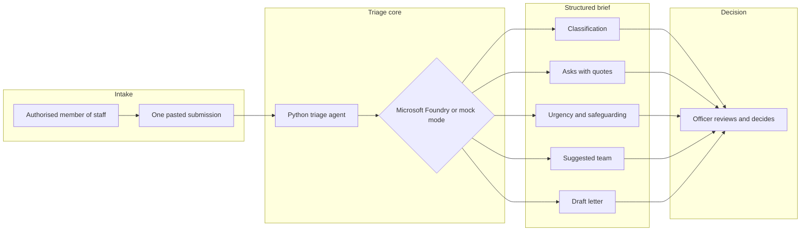
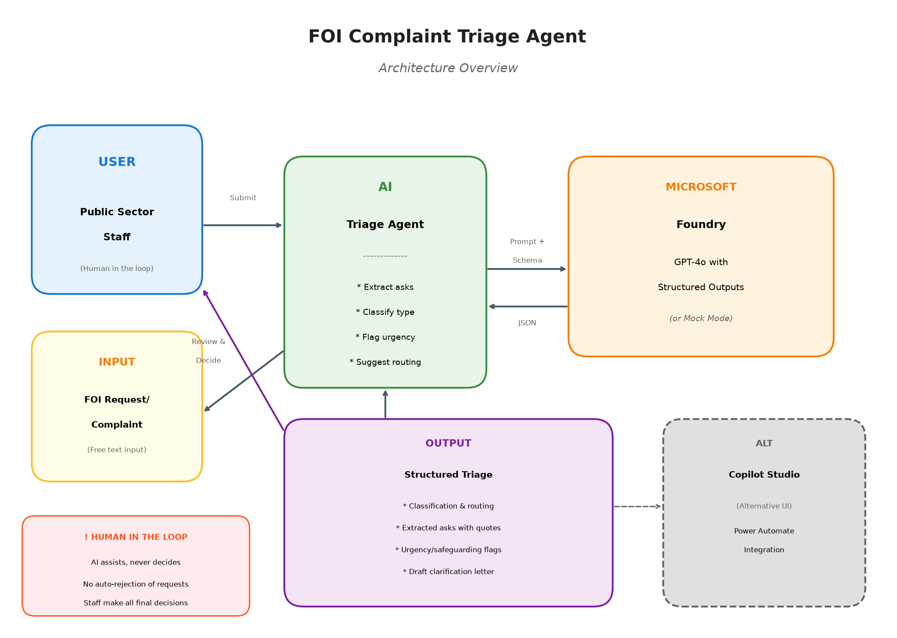
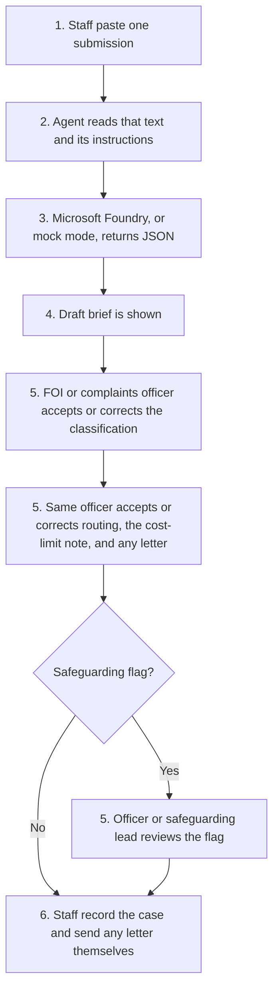

# FOI and Complaint Triage AI Agent for UK Public Sector (Copilot Studio and Microsoft Foundry)

FOI and complaint triage for UK public sector staff on Copilot Studio and Microsoft Foundry. An officer approves every output. The agent never sends or rejects. It reads one submission pasted by a member of staff and returns a structured brief: the separate asks, a suggested type, a suggested team, any urgency or safeguarding flag, a cost-limit note, and a draft clarification letter. Every example in this repository is synthetic. This is decision support for staff. It is not a decision, and it is not legal advice.

The permissions manifest (`agent-manifest.yaml`) wins if this page and the manifest disagree.

## Who this is for

Named roles, in UK public authorities and in regulated bodies that handle the same kind of intake:

- FOI officers and information-rights officers
- Complaints managers and complaint-handling leads
- Data protection officers and information governance managers
- Safeguarding leads, who need a flag from an officer, not an automated referral
- Solution architects and Power Platform leads who are choosing how Copilot Studio and Microsoft Foundry should sit in an existing case process

Sectors the pattern is written for: local authorities, ministerial and non-ministerial departments, NHS bodies, police forces, schools and universities that are public authorities, and arm's-length bodies. Environmental information requests also reach some utilities and other bodies covered by the Environmental Information Regulations 2004. A private regulated firm (financial services, telecoms, energy) can reuse the human-approval shape for complaint intake, but this repository does not implement the FCA Dispute Resolution rules, Ofcom or Ofgem complaint procedures, or an ombudsman scheme. Those rules have to be mapped before anyone relies on it.

## The problem

One email often mixes a complaint with a request for recorded information, environmental information, or the requester's own personal data. Staff have to split the asks, notice anything that looks urgent, judge whether the FOI cost limit may apply, and work out which team should take it. The statutory clock does not wait for that reading.

The Information Commissioner's Office (ICO) says an AI-written request is not invalid merely because AI was used. From [Freedom of Information (FOI) and Artificial Intelligence](https://ico.org.uk/for-organisations/foi/freedom-of-information-foi-and-artificial-intelligence/), retrieved 19 November 2026:

> Using AI to assist in writing a request is like using other kinds of technology.

The same page says the authority must still respond unless the request fails section 8 of the Freedom of Information Act 2000, and that staff may ask for clarification when the wording is unclear. A long or template-like request is still a request.

## What it does

From one free-text submission, pasted by an authorised member of staff:

- extracts each distinct ask, with a quote from the text
- suggests a type: FOI, EIR, subject access request, complaint, or mixed, with a rationale and a confidence level
- suggests a department and team
- flags urgency and safeguarding, including when a person should look immediately
- notes whether the request is likely to exceed the FOI cost limit
- drafts a clarification letter, where it thinks one is needed, for a person to edit
- records bulk or template signals as information only

The runnable core is Python in `src/`. With credentials it calls a model deployment. Without credentials, `--mock` uses rule-based Python so the pipeline can be tried. Mock mode is not a measure of model quality.

Two Copilot Studio harnesses can sit in front of that core. Both stop at the same approval points. Neither is an importable solution package.

| Harness | Use it for | Where it is written |
| --- | --- | --- |
| Standard harness | The same intake every time: paste, triage, show the JSON, stop | [copilot-studio/README.md](copilot-studio/README.md) |
| GitHub Copilot harness | Follow-up questions about that JSON | [docs/github-copilot-harness.md](docs/github-copilot-harness.md) and [skills/](skills/) |

The GitHub Copilot harness is a Copilot Studio runtime. It is not the GitHub Copilot product. Read [docs/harness-comparison.md](docs/harness-comparison.md) before spending Copilot Credits. This repository does not quote a price.

## What it does not do

Autonomy in this catalogue is A0, A1, or A2. Definitions are in [docs/autonomy-levels.md](docs/autonomy-levels.md). This agent is **A1: a person approves every action**. `auto_actions_enabled` is false. Level A3 is not permitted.

These are switched off in the manifest, not left to the prompt:

- It does not approve, reject, or close a request.
- It does not send email, letters, or any other message. A clarification letter is draft text.
- It does not write to a case system, a database, or any other store.
- It does not make the statutory decision, including exemptions, the cost limit, or a subject access response.
- It does not auto-reject because of wording, because the text looks AI-generated, or because it uses a template.
- It does not read case systems, HR records, finance systems, email, identity databases, or a requester's earlier requests.
- It does not give legal advice.
- It does not talk to the requester. The Customer Conversation harness is not used.

High-risk actions in the manifest (`approve_reject`, `regulated_decision`, `production_record_change`, `external_send`, `spend_transact`) are all disabled.

Some people use a tool or a template because of disability, language, or unfamiliarity with formal writing. Treating that as a reason to refuse would cut across the public sector equality duty. Section 149(1) of the Equality Act 2010, [legislation.gov.uk](https://www.legislation.gov.uk/ukpga/2010/15/section/149), says:

> A public authority must, in the exercise of its functions, have due regard to the need to— (a) eliminate discrimination, harassment, victimisation and any other conduct that is prohibited by or under this Act; (b) advance equality of opportunity between persons who share a relevant protected characteristic and persons who do not share it; (c) foster good relations between persons who share a relevant protected characteristic and persons who do not share it.

This repository does not discharge that duty. It refuses to build an automatic rejection on how the request is written. The authority still has the duty.

## Architecture





The diagram is generated by `docs/generate_diagram.py`. Copilot Studio, with a Power Automate flow, is an alternative interface to the same core. See [foundry/README.md](foundry/README.md).

## Human approval



| Before anyone relies on it | Who | In the manifest |
| --- | --- | --- |
| Accept the classification | FOI or complaints officer | Mandatory |
| Act on the routing suggestion | FOI or complaints officer | Mandatory |
| Apply the cost-limit assessment | FOI or complaints officer | Mandatory |
| Send the clarification letter | FOI or complaints officer | Mandatory. The agent only drafts it |
| Escalate a safeguarding flag | FOI or complaints officer, or the safeguarding lead | Mandatory. The one-hour figure in the manifest is an assumption |

Viewing the draft, or running the triage again, has no external effect and does not need a separate approval. Anything after step 6 happens in the systems the organisation already uses. The agent has no connector for that.

## Governance

Least privilege is the manifest, not a slogan. A run may read the submission a member of staff pastes, and the static instructions. It may not read case history or the requester's other records. Writes are disabled. Sends are disabled. The agent does not persist the text. What staff then file is the organisation's retention schedule, which this repository does not set.

Contacts in the manifest (`foi-triage-support@example.gov.uk` and the other `example.gov.uk` addresses) are placeholders.

### UK GDPR and the Data Protection Act 2018

The manifest records the basis a public-authority controller would be expected to consider. It is not a completed legitimate-interest assessment, and it is not a data protection impact assessment.

Article 6(1)(c) of the UK GDPR, as revised on [legislation.gov.uk](https://www.legislation.gov.uk/eur/2016/679/article/6) and retrieved 19 November 2026:

> processing is necessary for compliance with a legal obligation to which the controller is subject;

Article 6(1)(e), same page, after the Data (Use and Access) Act 2025 amendments shown there:

> processing is necessary for the performance of a task of the controller carried out in the public interest or a task carried out in the exercise of official authority vested in the controller;

The manifest uses Article 6(1)(e) as the primary basis and Article 6(1)(c) as the secondary basis, because answering FOI, EIR, and subject access requests is a statutory duty. Article 6(3) on the same page says the basis for point (e) must be laid down by domestic law or relevant international law. The domestic law for this pattern is the legislation quoted below, together with the Data Protection Act 2018. The controller confirms that before go-live.

A submission may contain special-category data (health, political opinions, and so on). Article 9(2)(g) of the UK GDPR, as revised on [legislation.gov.uk](https://www.legislation.gov.uk/eur/2016/679/article/9) and retrieved 19 November 2026:

> processing is necessary for reasons of substantial public interest, on the basis of domestic law, or relevant international law, which shall be proportionate to the aim pursued and provide for suitable and specific measures to safeguard the fundamental rights and the interests of the data subject;

The legislation.gov.uk page shows an editorial ellipsis between "pursued" and "and", where the [Data Protection (Fundamental Rights and Freedoms) (Amendment) Regulations 2023](https://www.legislation.gov.uk/uksi/2023/1417/contents) omitted earlier words. The quotation above is the words that remain, without that editorial mark.

The manifest points at Data Protection Act 2018, Schedule 1, Part 2, paragraph 6 (statutory and government purposes). Paragraph 6(1) and (2), retrieved the same day from [legislation.gov.uk](https://www.legislation.gov.uk/ukpga/2018/12/schedule/1/paragraph/6):

> (1) This condition is met if the processing— (a) is necessary for a purpose listed in sub-paragraph (2), and (b) is necessary for reasons of substantial public interest. (2) Those purposes are— (a) the exercise of a function conferred on a person by an enactment or rule of law; (b) the exercise of a function of the Crown, a Minister of the Crown or a government department.

Safeguards named in the manifest: classification only, no decision taken on that data, human review, and no persistence beyond the session. Article 9(5) says [section 10 of the 2018 Act](https://www.legislation.gov.uk/ukpga/2018/12/section/10) makes provision about when the domestic-law basis in Article 9(2)(g) is met. Confirm the condition with your data protection officer. Production inference is assumed to run in UK South or UK West. That assumption is for the deploying organisation to confirm.

The right of access itself is [Article 15 UK GDPR](https://www.legislation.gov.uk/eur/2016/679/article/15). This agent does not fulfil a subject access request. Staff do.

### FOI, EIR, and the cost limit

Freedom of Information Act 2000, section 1(1), [legislation.gov.uk](https://www.legislation.gov.uk/ukpga/2000/36/section/1):

> Any person making a request for information to a public authority is entitled— (a) to be informed in writing by the public authority whether it holds information of the description specified in the request, and (b) if that is the case, to have that information communicated to him.

Section 8(1), [legislation.gov.uk](https://www.legislation.gov.uk/ukpga/2000/36/section/8), is the validity test the ICO points to for AI-written requests:

> In this Act any reference to a “request for information” is a reference to such a request which— (a) is in writing, (b) states the name of the applicant and an address for correspondence, and (c) describes the information requested.

Section 10(1), [legislation.gov.uk](https://www.legislation.gov.uk/ukpga/2000/36/section/10):

> Subject to subsections (2) and (3), a public authority must comply with section 1(1) promptly and in any event not later than the twentieth working day following the date of receipt.

Section 12(1), [legislation.gov.uk](https://www.legislation.gov.uk/ukpga/2000/36/section/12):

> Section 1(1) does not oblige a public authority to comply with a request for information if the authority estimates that the cost of complying with the request would exceed the appropriate limit.

The appropriate limit is set by the Freedom of Information and Data Protection (Appropriate Limit and Fees) Regulations 2004. Regulation 3(2) and (3), [legislation.gov.uk](https://www.legislation.gov.uk/uksi/2004/3244/regulation/3):

> (2) In the case of a public authority which is listed in Part I of Schedule 1 to the 2000 Act, the appropriate limit is £600. (3) In the case of any other public authority, the appropriate limit is £450.

Regulation 4(4), [legislation.gov.uk](https://www.legislation.gov.uk/uksi/2004/3244/regulation/4), estimates staff time at £25 per person per hour, and only for determining whether the information is held, locating it, retrieving it, and extracting it. The agent's cost note is a prompt for that estimate. It is not the estimate.

Section 16(1), [legislation.gov.uk](https://www.legislation.gov.uk/ukpga/2000/36/section/16):

> It shall be the duty of a public authority to provide advice and assistance, so far as it would be reasonable to expect the authority to do so, to persons who propose to make, or have made, requests for information to it.

Section 16(2) treats conformity with the section 45 code as compliance with that duty in that case. The current code is the [Freedom of Information Code of Practice](https://www.gov.uk/government/publications/freedom-of-information-code-of-practice) (Cabinet Office). The draft clarification letter is there so an officer can meet that duty. The agent does not send it.

Environmental Information Regulations 2004, regulation 5(1) and (2), [legislation.gov.uk](https://www.legislation.gov.uk/uksi/2004/3391/regulation/5):

> (1) Subject to paragraph (3) and in accordance with paragraphs (2), (4), (5) and (6) and the remaining provisions of this Part and Part 3 of these Regulations, a public authority that holds environmental information shall make it available on request. (2) Information shall be made available under paragraph (1) as soon as possible and no later than 20 working days after the date of receipt of the request.

Regulation 9(1), [legislation.gov.uk](https://www.legislation.gov.uk/uksi/2004/3391/regulation/9):

> A public authority shall provide advice and assistance, so far as it would be reasonable to expect the authority to do so, to applicants and prospective applicants.

### Regulator guidance

- ICO, [Freedom of Information (FOI) and Artificial Intelligence](https://ico.org.uk/for-organisations/foi/freedom-of-information-foi-and-artificial-intelligence/). AI assistance does not by itself make a request invalid. Inaccuracies in an AI-drafted request do not by themselves make it invalid. Clarify under section 1(3) when the description is unclear, and give advice and assistance under section 16.
- ICO, [Recognising a request made under the Freedom of Information Act (section 8)](https://ico.org.uk/for-organisations/foi/freedom-of-information-and-environmental-information-regulations/recognising-a-request-made-under-the-freedom-of-information-act-section-8/).
- ICO, [Section 16 — Advice and assistance](https://ico.org.uk/for-organisations/foi/freedom-of-information-and-environmental-information-regulations/section-16-advice-and-assistance/).
- ICO, [Guidance on AI and data protection](https://ico.org.uk/for-organisations/uk-gdpr-guidance-and-resources/artificial-intelligence/guidance-on-ai-and-data-protection/), and [Public task](https://ico.org.uk/for-organisations/uk-gdpr-guidance-and-resources/lawful-basis/a-guide-to-lawful-basis/public-task/) as the ICO's guide to Article 6(1)(e).
- Cabinet Office, [Freedom of Information Code of Practice](https://www.gov.uk/government/publications/freedom-of-information-code-of-practice), under section 45.
- Complaints about councils and care providers in England are for the authority's own procedure and, after that, the [Local Government and Social Care Ombudsman](https://www.lgo.org.uk/). Complaints about UK government departments and the NHS in England are for the [Parliamentary and Health Service Ombudsman](https://www.ombudsman.org.uk/). NHS and social-care complaint handling in England is also under the [Local Authority Social Services and National Health Service Complaints (England) Regulations 2009](https://www.legislation.gov.uk/uksi/2009/309/contents). This agent does not decide those complaints and does not draft an ombudsman response.

### Algorithmic Transparency Recording Standard

The standard and the published records are collected at the [Algorithmic Transparency Recording Standard hub](https://www.gov.uk/government/collections/algorithmic-transparency-recording-standard-hub). How to complete a record: [Guidance for organisations using the Algorithmic Transparency Recording Standard](https://www.gov.uk/government/publications/guidance-for-organisations-using-the-algorithmic-transparency-recording-standard).

The [mandatory scope and exemptions policy](https://www.gov.uk/government/publications/algorithmic-transparency-recording-standard-mandatory-scope-and-exemptions-policy/algorithmic-transparency-recording-standard-atrs-mandatory-scope-and-exemptions-policy), retrieved 19 November 2026, says the mandatory requirement currently applies to central government: ministerial departments, non-ministerial departments, and arm's-length bodies that provide public or frontline services or routinely interact with the public. On which tools:

> The mandatory requirement to publish an ATRS record applies to algorithmic tools that either: 1. have a significant influence on a decision-making process with public effect, or 2. directly interact with the general public.

> ‘Significant influence’ includes where an algorithmic tool meaningfully assists, supplements, or fully automates a decision-making process. This could be a tool that plays a triaging or scoring function within a wider process.

A triage assistant can fall inside that sentence once it is in beta, pilot, or production and it is influencing operational decisions. This repository is a starter, not a deployed tool, and it does not file a record. The organisation decides, completes the template, and sends it. The manifest's `atrs_mapping` section only points manifest fields at ATRS fields. Local authorities are outside that mandatory central-government list; voluntary publication is still described in the policy.

### Product name

The live model host is Microsoft Foundry. That product was formerly called Azure AI Foundry. Source: [What is Microsoft Foundry?](https://learn.microsoft.com/en-us/azure/foundry/what-is-foundry), which lists the previous brand as Azure AI Studio / Azure AI Foundry.

## Quick start

Python 3.10 or newer. No credentials are required for mock mode. No key is stored in the repository.

```bash
git clone https://github.com/rahul-bachina/foi-complaint-triage-copilot-agent.git
cd foi-complaint-triage-copilot-agent
python -m pip install -r requirements.txt
python -m pytest tests/ -v --tb=short
python src/triage_agent.py --mock --input examples/sample_request.txt
python eval/evaluate.py
```

`python -m src.triage_agent --mock --input examples/sample_request.txt` is the same entry point, imported as a package.

### Microsoft Foundry

```bash
export AZURE_OPENAI_ENDPOINT="https://your-resource.openai.azure.com"
export AZURE_OPENAI_API_KEY="your-key"
export AZURE_OPENAI_DEPLOYMENT="gpt-4o"
python src/triage_agent.py --input examples/sample_request.txt
```

Those values are placeholders. See [foundry/README.md](foundry/README.md). Do not point this at a live request until the region, identity, and logging assumptions in the manifest have been confirmed.

### Copilot Studio

There is nothing to import. Copilot Studio agents are not reliably exported as a solution zip.

1. Standard harness: follow [copilot-studio/README.md](copilot-studio/README.md), [copilot-studio/system-prompt.md](copilot-studio/system-prompt.md), and [copilot-studio/power-automate-flow.md](copilot-studio/power-automate-flow.md). Do not upload the files in `skills/` onto that agent.
2. GitHub Copilot harness: follow [docs/github-copilot-harness.md](docs/github-copilot-harness.md). Building and testing it consumes Copilot Credits from the start of building, on the Microsoft page cited in the harness comparison (retrieved 24 October 2026). Confirm the current price in the tenant. This repository does not quote one.

## Evaluation results

Ran on 19 November 2026 in mock mode against `eval/synthetic_dataset.json` (12 synthetic cases). The command was `python eval/evaluate.py`.

| Result | Value |
| --- | --- |
| Cases processed | 12 of 12 |
| Errors | 0 |
| Agreement with the expected fields | 100.0% |
| Classification | 12 of 12 asserted cases |
| Flags | 10 of 10 asserted cases |
| Routing | 8 of 8 asserted cases |
| Cost-limit assessment | 6 of 6 asserted cases |
| Bulk-submission signals | 2 of 2 asserted cases |

Not every case asserts every field, which is why the field rows are not all out of 12. The mock classifier is rule-based and was tuned to this set. A pass means the pipeline returns schema-shaped JSON and the rules match the labels the dataset already expects. It says nothing about how a model would classify a new request. A live-model evaluation against Microsoft Foundry has not been run. "What I learned" in the upstream notes is still empty for that reason.

The dataset file states that all of its data is synthetic. There are no real requests and no real people.

## Limitations

- Mock mode is keyword matching. It will not behave like a model, and the 100% figure above is not an accuracy claim.
- The agent does not learn from staff decisions. That is deliberate.
- Classification assumes the UK FOI, EIR, and data-protection framework. It does not apply exemptions.
- It is not a legal tool. The quotations above are there so a buyer can see the source. They are not advice on a particular request.
- Several deployment choices are marked as assumptions in the manifest: UK region, retention, a one-hour safeguarding review, Application Insights, the escalation contacts, and the reviewing board.
- The security guide's notes on Dynamic Permissions, Dynamic Agent Risk, and Dynamic Conditional Access were unverified when written. Do not rely on them until you confirm availability.
- Copilot Credit prices, and which licence includes which harness, were not copied beyond the sentences on the pages opened on 24 October 2026. The full standard-harness licensing article was not opened. See [docs/harness-comparison.md](docs/harness-comparison.md).
- The upstream experiment README cites a Sky News report of 20 October 2026 for percentage increases in council and DWP complaints. This page does not repeat those figures. An automated fetch of that URL was refused (HTTP 403), so they are not treated as verified here.

## FAQ

### Does this disclose information or refuse a request?

No. Section 1 of the Freedom of Information Act 2000 is a duty on the public authority. The agent drafts a brief. An officer decides whether information is held, whether an exemption applies, and what is sent.

### Are AI-written requests treated as invalid?

No. The ICO's position, quoted above, is that using AI is like using other technology. The validity test is section 8. Bulk or template signals in the JSON are information only and must not be used as a reason to reject.

### Can I import a Copilot Studio solution?

No. `copilot-studio/` is a build guide. You recreate the topics and the flow in your tenant. Skills in `skills/` belong to the GitHub Copilot harness, not the standard harness, and an agent cannot be moved from one harness to the other.

### What did the evaluation actually prove?

That mock mode processes 12 synthetic cases and agrees with the labels in that file. It did not call a model. A buyer should not cite 100% as model accuracy.

### What personal data does a run touch?

The text the officer pastes, which may contain names, contact details, and special-category data, plus the static instructions. The agent does not store it and does not look the requester up. Retention of the case the officer then files is the organisation's schedule.

### What is autonomy A1, in practice?

The agent can suggest. It cannot act. Five approvals are mandatory: classification, routing, cost limit, sending a letter, and escalating a safeguarding flag. A0 would be analysis with no suggested action at all. A2 would allow low-risk actions without approval. A3, fully autonomous, is out of scope. This build is A1.

### Where should the model run?

The manifest says UK South or UK West for production. Confirm the region, the retention of prompts, and prompt shields in your tenant before a real submission is processed. Mock mode needs no region because it never leaves the machine.

### Is this a DPIA, an ATRS record, or a legal opinion?

No. It is a starter with a manifest, a risk note, and citations. Your data protection officer owns the DPIA. Your organisation owns any ATRS record. Counsel owns the legal position on a live request.

## Part of the Copilot Agent Experiments catalogue

This repository is experiment 01 published on its own, so a buyer can find it without cloning the whole catalogue.

- Catalogue source: https://github.com/rahul-bachina/copilot-agent-experiments
- Catalogue site: https://rahul-bachina.github.io/copilot-agent-experiments/
- Experiment folder in the hub: https://github.com/rahul-bachina/copilot-agent-experiments/tree/main/experiments/01-foi-complaint-triage

The hub copy of the experiment README, with paths adjusted for this repository, is [UPSTREAM.md](UPSTREAM.md). The catalogue page snapshot is [docs/catalogue-page.md](docs/catalogue-page.md).

## Work with me

Rahul Bachina is a UK Solution Architect covering Power Platform, Copilot Studio, Microsoft Foundry, Azure AI, and GitHub Copilot. He can adapt this agent to your organisation's case system, teams, and approval route.

Contact via GitHub: https://github.com/rahul-bachina

**LinkedIn:** TODO: add Rahul Bachina's LinkedIn URL here. Do not invent one.

To ask for that adaptation, open a [request an adaptation for my organisation](https://github.com/rahul-bachina/foi-complaint-triage-copilot-agent/issues/new?template=request-an-adaptation.yml). Do not include live requests or personal data.

## Maintenance

`.github/workflows/sync-from-hub.yml` runs every Monday at 07:00 UTC, and whenever someone starts it by hand. It clones the public hub over HTTPS, copies `experiments/01-foi-complaint-triage/` onto the matching paths in this repository, refreshes the shared manifest schema and the catalogue page, rewrites hub-relative imports, and opens a pull request with [peter-evans/create-pull-request](https://github.com/peter-evans/create-pull-request) using `GITHUB_TOKEN` only if something changed.

It does not overwrite the standalone files listed in [.sync-ignore](.sync-ignore). That list includes this README, `llms.txt`, `llms-full.txt`, `CITATION.cff`, `SECURITY.md`, `CONTRIBUTING.md`, `.github/`, `site/`, `scripts/`, and `foundry/`.

For the sync workflow to open pull requests, the repository setting **Allow GitHub Actions to create and approve pull requests** must be on (Settings, Actions, General). The workflow sets `contents: write` and `pull-requests: write`. If the repository's default workflow token is restricted to read-only, change Workflow permissions to read and write as well, or the job cannot push the sync branch.

Review every sync pull request. A hub change that enables a send or a write should fail `scripts/validate_schemas.py` until someone deals with it deliberately.

## Licence

MIT. See [LICENSE](LICENSE). Copyright (c) 2026 Rahul Bachina.

## Files a reviewer usually opens

| File | What it is |
| --- | --- |
| [agent-manifest.yaml](agent-manifest.yaml) | Permissions, lawful basis, approvals, risks, kill switch |
| [docs/security-and-permissions.md](docs/security-and-permissions.md) | The same manifest, written for governance readers |
| [schema/triage_output.schema.json](schema/triage_output.schema.json) | Shape of the JSON brief |
| [schemas/agent-manifest.schema.json](schemas/agent-manifest.schema.json) | Schema the manifest is validated against |
| [eval/synthetic_dataset.json](eval/synthetic_dataset.json) | 12 synthetic cases |
| [llms.txt](llms.txt) | Short map for language models |
